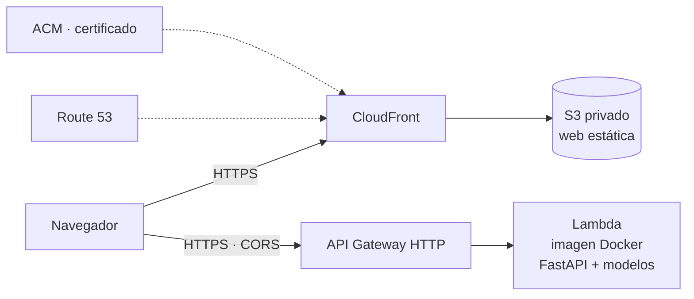

# Scoring de riesgos de crédito · Demo en AWS

[English](README.md) · **Español**

Modelo de riesgo de crédito (**PD × EAD × LGD**) servido como API en AWS Lambda
y con una web bilingüe (ES/EN) para evaluarlo.

**Demo en vivo:** https://scoring.drm-data.com

> Proyecto académico de ciencia de datos. Los datos y el modelo entrenado
> **no se incluyen** en este repositorio (ver "Datos").

## Qué hace
Dado un cliente y las condiciones de un préstamo (importe, interés, plazo,
finalidad y vivienda), la API devuelve:

| Campo | Significado |
|---|---|
| `score_pd` | Probabilidad de impago (*Probability of Default*) |
| `score_ead` | Exposición en el impago (*Exposure at Default*), fracción del préstamo |
| `score_lgd` | Pérdida en caso de impago (*Loss Given Default*), fracción |
| `perdida_esperada` | `PD × EAD × LGD` |

## Modelos y resultados
Entrenados con 140.000 préstamos y evaluados en 60.000 reservados para validación.

| Modelo | Algoritmo | Métrica (validación) |
|---|---|---|
| PD | Regresión logística (L1, `saga`) | AUC = **0,699** |
| EAD | HistGradientBoostingRegressor | MAE = **0,160** |
| LGD | HistGradientBoostingRegressor | MAE = **0,089** |

Hiperparámetros elegidos con `GridSearchCV` (5 folds para PD, 3 para EAD y LGD).

## Glosario
Términos de riesgo de crédito y de análisis que aparecen en el proyecto.

**Riesgo de crédito**

| Término | Qué es | Ejemplo |
|---|---|---|
| **PD** (*Probability of Default*) | Probabilidad de que el cliente deje de pagar el préstamo (0–1). | 0,15: 15 de cada 100 préstamos parecidos acaban impagados. |
| **EAD** (*Exposure at Default*) | Parte del importe que el cliente aún debía cuando dejó de pagar: (importe − devuelto) / importe. | Préstamo de 10.000 $ con 4.000 $ devueltos al impagar: EAD = 0,6. |
| **LGD** (*Loss Given Default*) | Parte de esa deuda pendiente que no se recupera nunca: 1 − recuperado / pendiente. | Debía 6.000 $ y se recuperan 780 $: LGD = 0,87. |
| **Pérdida esperada** | PD × EAD × LGD × importe: lo que se espera perder de media con el préstamo. | 0,15 × 0,6 × 0,87 × 10.000 $ = 783 $. |

**Análisis y modelos**

| Término | Qué es | Cómo se lee |
|---|---|---|
| **WoE** (*Weight of Evidence*) | Para un grupo de una variable: ln(% de todos los préstamos buenos que hay en el grupo / % de todos los malos). | 0 = riesgo medio; positivo = menos riesgo; negativo = más riesgo. |
| **IV** (*Information Value*) | Suma de (% buenos − % malos) × WoE de todos los grupos: cuánto separa una variable a los buenos de los malos. | < 0,02 nada · 0,02–0,1 débil · 0,1–0,3 medio · > 0,3 fuerte (> 0,5, sospecha de *leakage*). |
| **PSI** (*Population Stability Index*) | Misma fórmula que el IV, pero compara el reparto de una variable entre dos periodos. | < 0,1 estable · 0,1–0,25 cambio moderado · > 0,25 cambio importante. |
| **AUC** | Probabilidad de que el modelo dé más riesgo a un préstamo impagado que a uno devuelto, tomados al azar. | 0,5 = azar · 1 = perfecto · 0,65–0,75 es lo habitual con datos de solicitud. |
| ***Leakage*** (fuga de información) | Usar al entrenar datos que no se conocen en el momento de decidir (por ejemplo, lo que el cliente ya ha pagado). | Da métricas excelentes en el notebook y un modelo inútil en la realidad. |

## Arquitectura


- **API:** FastAPI empaquetada con Mangum en una imagen Docker sobre AWS Lambda.
- **Web:** HTML, CSS y JavaScript sin dependencias, en un bucket S3 privado
  servido por CloudFront (acceso mediante Origin Access Control).
- **Dominio y HTTPS:** Route 53 + certificado de ACM.
- **Infraestructura como código:** AWS SAM / CloudFormation (`template.yaml`).

## Estructura
```
07_despliegue_aws/
├── api/                      # FastAPI + Dockerfile
├── frontend/                 # Web estática bilingüe
├── pruebas/                  # Eventos de prueba para sam local
├── template.yaml             # Infraestructura (SAM)
├── samconfig.toml.example    # Configuración de despliegue (plantilla)
├── deploy.ps1                # Publica la web en S3 e invalida CloudFront
└── preparar_clientes.py      # Genera el CSV de clientes de la demo
```

## Tecnologías
Python · scikit-learn · FastAPI · Docker · AWS (Lambda, API Gateway, S3,
CloudFront, Route 53, ACM) · AWS SAM · HTML/CSS/JavaScript.

## Datos
Los datos proceden de un curso de ciencia de datos y **no se redistribuyen**.
Para reproducir el proyecto hacen falta: el dataset de préstamos, el artefacto
del pipeline (`artefacto_pipeline.pkl`, con `pipe_pd`, `pipe_ead` y `pipe_lgd`)
y el CSV de clientes (`preparar_clientes.py`) en `api/app/`.

## Despliegue
```powershell
cd 07_despliegue_aws
copy samconfig.toml.example samconfig.toml   # y rellena tus valores
sam build
sam deploy
.\deploy.ps1                                 # publica la web
```
Requisitos: AWS CLI configurado, SAM CLI y Docker.

## Limitaciones y próximos pasos
- El AUC del modelo de PD (0,70) es moderado; hay margen de mejora en variables y algoritmo.
- La API es pública y sin autenticación (limitada por *throttling* y CORS); suficiente para una demo.
- Los clientes de la demo se sustituirán por datos sintéticos.

## Autor
Pedro Delgado · [drm-data.com](https://drm-data.com) · [GitHub](https://github.com/PedroDelgado08)
