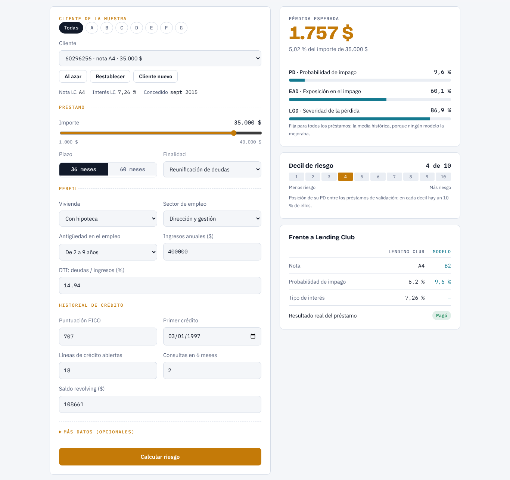
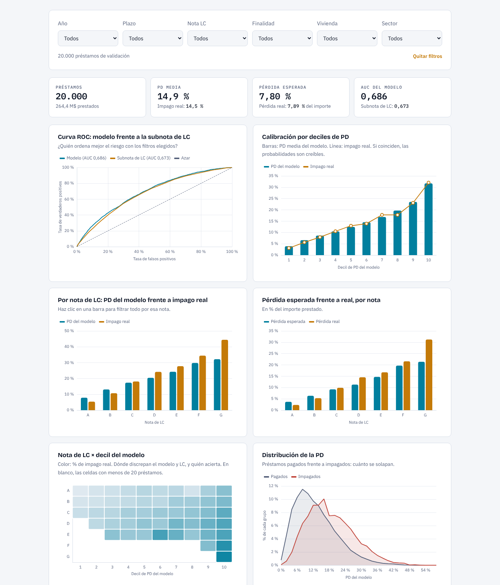
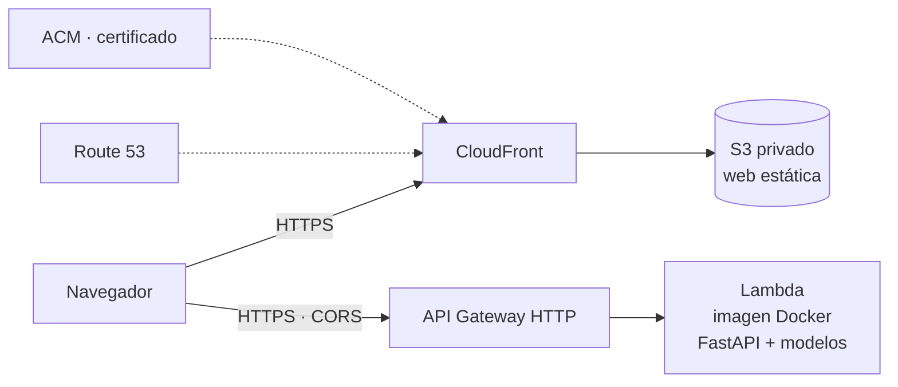

# Scoring de riesgos de crédito · Demo en AWS

[English](README.md) · **Español**

Tres modelos de *machine learning* estiman cuánto se puede perder con un préstamo
(**pérdida esperada = PD × EAD × LGD**). Se entrenan con préstamos reales de Lending Club
y se sirven como una API en AWS Lambda, con una web bilingüe (ES/EN) para probarlos.

**Demo en vivo:** https://scoring.drm-data.com



## Qué hace

La web tiene dos pestañas:

- **Simulador.** Eliges un cliente real de la muestra de validación, o creas uno nuevo, y cambias sus datos si quieres. La API devuelve su PD, EAD, LGD y pérdida esperada en $, junto con su decil de riesgo. Para los clientes de la muestra se añaden la nota que le puso Lending Club y lo que pasó de verdad con el préstamo.
- **Cartera.** Es un cuadro de mando con 20.000 préstamos de validación ya puntuados. Muestra la curva ROC del modelo frente a la subnota de Lending Club, la calibración por deciles, la pérdida esperada frente a la real por nota y la distribución de la PD. Los gráficos se filtran por año, plazo, nota, finalidad, vivienda y sector.



## Resultados

Los modelos se entrenan con 443.469 préstamos y se evalúan **una sola vez** con 190.059 préstamos apartados desde el principio (validación). Son préstamos de Lending Club concedidos entre 2012 y 2015, ya terminados.

| Modelo | Qué estima | Algoritmo | Validación |
|---|---|---|---|
| **PD** | Probabilidad de impago | *Gradient boosting* (`HistGradientBoostingClassifier`) | AUC **0,678**, frente a **0,670** de la subnota de Lending Club |
| **EAD** | Parte del importe pendiente al impagar | Regresión Ridge (`alpha` 100) | RMSE 0,235, frente a 0,238 de usar la media de cada plazo |
| **LGD** | Parte de lo pendiente que no se recupera | Media de entrenamiento (0,869) | RMSE 0,147: ningún modelo mejoraba la media |

Sobre toda la cartera de validación (2.510 millones de $ prestados), los tres modelos juntos calculan una **pérdida esperada del 7,75 %**, frente a una **pérdida real del 7,87 %**: un error del 1,5 %.

## Cómo se ha hecho

Cada paso es un notebook en `03_notebooks/es/` y tiene un informe con sus decisiones en `00_informes/`.

| # | Notebook | Qué se hace |
|---|---|---|
| 01 | [Importación de datos](00_informes/01_ImportacionDatos.md) | De 2,26 millones de préstamos se queda con los 633.528 terminados y modelizables, y los divide en entrenamiento (70 %) y validación (30 %). |
| 02 | [Calidad de datos](00_informes/02_CalidadDatos.md) | Revisa nulos, categorías, formatos y valores atípicos. |
| 03 | [Análisis exploratorio](00_informes/03_EDA.md) | Relaciona cada variable con el impago (WoE, IV) y comprueba su estabilidad en el tiempo (PSI). |
| 04 | [Transformación](00_informes/04_TransformacionDatos.md) | Crea los objetivos de PD, EAD y LGD y la preparación de las variables (`04_scripts/preparacion.py`). |
| 05 | [Modelo PD](00_informes/05_ModeloPD.md) | Compara regresión logística y *gradient boosting* con búsqueda en rejilla y validación cruzada. |
| 06 | [Modelo EAD](00_informes/06_ModeloEAD.md) | Compara la media, Ridge y *gradient boosting* con los préstamos impagados. |
| 07 | [Modelo LGD](00_informes/07_ModeloLGD.md) | Igual que el 06, para la LGD. |
| 08 | [Validación final](00_informes/08_ValidacionFinal.md) | Evalúa los tres modelos con la validación y compara la pérdida esperada con la real. |

Los notebooks y los informes están en español. Los notebooks 01 y 02 tienen también versión en inglés en `03_notebooks/en/`.

## Arquitectura



- **API:** FastAPI adaptada a Lambda con Mangum, dentro de una imagen Docker (Python 3.11) que lleva los tres modelos. La función tiene 1.024 MB, y el primer arranque tras un rato sin uso tarda unos 4 segundos. Por eso la web llama a `/health` al abrirse.
- **Web:** HTML, CSS y JavaScript sin *frameworks* y gráficos con ECharts. Se guarda en un bucket S3 privado y la sirve CloudFront, que es el único que puede leer el bucket (*Origin Access Control*).
- **Dominio y HTTPS:** Route 53 y un certificado de ACM.
- **Infraestructura como código:** todo se crea con AWS SAM / CloudFormation (`template.yaml`).
- **Límites:** la API es pública y sin autenticación. API Gateway la limita a 5 peticiones por segundo, con picos de 10.

### API

| Ruta | Método | Qué devuelve |
|---|---|---|
| `/health` | GET | `{"status": "ok"}`; sirve para despertar la Lambda |
| `/clientes` | GET | Los clientes de la muestra de validación que usa el simulador |
| `/predict` | POST | PD, EAD, LGD, pérdida esperada, decil de riesgo y, si se indica `id_cliente`, la comparación con Lending Club |

Ejemplo con un cliente nuevo:

```bash
curl -X POST https://8ge1a1ntk1.execute-api.eu-central-1.amazonaws.com/predict \
  -H "Content-Type: application/json" \
  -d '[{"principal": 15000, "num_cuotas": 36, "finalidad": "debt_consolidation",
        "vivienda": "MORTGAGE", "sector_empleo": "direccion_gestion",
        "antigüedad_empleo": "2-9", "ingresos": 65000, "dti": 18.5, "fico": 700,
        "num_lineas_credito": 10, "saldo_revolving": 12000,
        "num_consultas_6meses": 1, "fecha_primer_credito": "2005-06-01"}]'
```

La lista completa de campos y sus valores posibles está en `07_despliegue_aws/api/app/schemas.py`.

## Estructura

```
├── 00_informes/                # Un informe por notebook: decisiones y resultados
├── 03_notebooks/
│   ├── es/                     # Notebooks 01–08
│   └── en/                     # Versión en inglés (01–02)
├── 04_scripts/
│   └── preparacion.py          # Preparación de variables, compartida por los tres modelos
└── 07_despliegue_aws/
    ├── api/                    # FastAPI + Dockerfile
    ├── frontend/               # Web estática bilingüe (simulador y cartera)
    ├── pruebas/                # Eventos de prueba para sam local
    ├── preparar_datos_demo.py  # Copia los modelos y genera los datos de la demo
    ├── template.yaml           # Infraestructura (SAM)
    ├── samconfig.toml.example  # Configuración del despliegue (plantilla)
    └── deploy.ps1              # Publica la web en S3 e invalida la caché de CloudFront
```

## Datos y reproducción

Los datos son el dataset público [*All Lending Club loan data*](https://www.kaggle.com/datasets/wordsforthewise/lending-club) de Kaggle (licencia CC0). No se incluyen en el repositorio porque ocupan 1,7 GB. Tampoco se incluyen los modelos entrenados (`.pkl`) ni los datos de la demo, que se generan a partir de los datos.

Para reproducirlo:

1. Descarga el dataset y guarda `accepted_2007_to_2018Q4.csv` en `02_datos/00_Originales/`.
2. Ejecuta los notebooks 01 a 08 en orden, con Python 3.11 y las versiones de `07_despliegue_aws/api/requirements.txt`. Los modelos se guardan en `05_modelos/`.
3. Despliega:

```powershell
cd 07_despliegue_aws
python preparar_datos_demo.py                # copia los modelos y genera los datos de la demo
copy samconfig.toml.example samconfig.toml   # y rellena tus valores
sam build
sam deploy
.\deploy.ps1                                 # publica la web
```

Requisitos: AWS CLI configurada, SAM CLI y Docker.

## Limitaciones

- **La PD es más plana que la nota de Lending Club.** Sobreestima el riesgo de las notas A y B y lo subestima de la D a la G. La nota usa información que el formulario no tiene, como el historial completo del buró o la verificación de ingresos. Aun así, dentro de cada nota el modelo ordena el riesgo mejor que las subnotas.
- **La EAD y la LGD apenas se pueden predecir con los datos de la solicitud.** La EAD mejora solo un 2,3 % el error de predecir siempre la media, y la LGD es directamente la media.
- **La validación es de los mismos años que el entrenamiento (2012–2015).** Mide si el modelo generaliza a clientes parecidos, no si aguanta un cambio de época. En producción habría que vigilar la estabilidad (PSI) y recalibrar.
- **La pérdida real no incluye** intereses no cobrados, costes de cobro ni el valor temporal del dinero.

## Glosario

**Riesgo de crédito**

| Término | Qué es | Ejemplo |
|---|---|---|
| **PD** (*Probability of Default*) | Probabilidad de que el cliente deje de pagar el préstamo (0–1). | 0,15: 15 de cada 100 préstamos parecidos acaban impagados. |
| **EAD** (*Exposure at Default*) | Parte del importe que el cliente aún debía cuando dejó de pagar: (importe − devuelto) / importe. | Préstamo de 10.000 $ con 4.000 $ devueltos al impagar: EAD = 0,6. |
| **LGD** (*Loss Given Default*) | Parte de esa deuda pendiente que no se recupera nunca: 1 − recuperado / pendiente. | Debía 6.000 $ y se recuperan 780 $: LGD = 0,87. |
| **Pérdida esperada** | PD × EAD × LGD × importe: lo que se espera perder de media con el préstamo. | 0,15 × 0,6 × 0,87 × 10.000 $ = 783 $. |
| **Nota de Lending Club** | Calificación de riesgo que Lending Club daba a cada préstamo: de A (menos riesgo) a G, cada una con 5 subnotas (A1–G5). | Es la referencia con la que se compara la PD del modelo. |

**Análisis y modelos**

| Término | Qué es | Cómo se lee |
|---|---|---|
| **WoE** (*Weight of Evidence*) | Para un grupo de una variable: ln(% de todos los préstamos buenos que hay en el grupo / % de todos los malos). | 0 = riesgo medio; positivo = menos riesgo; negativo = más riesgo. |
| **IV** (*Information Value*) | Suma de (% buenos − % malos) × WoE de todos los grupos: cuánto separa una variable a los buenos de los malos. | < 0,02 nada · 0,02–0,1 débil · 0,1–0,3 medio · > 0,3 fuerte (> 0,5, sospecha de *leakage*). |
| **PSI** (*Population Stability Index*) | Misma fórmula que el IV, pero compara el reparto de una variable entre dos periodos. | < 0,1 estable · 0,1–0,25 cambio moderado · > 0,25 cambio importante. |
| **AUC** | Probabilidad de que el modelo dé más riesgo a un préstamo impagado que a uno devuelto, tomados al azar. | 0,5 = azar · 1 = perfecto · 0,65–0,75 es lo habitual con datos de solicitud. |
| **RMSE** | Raíz del error cuadrático medio: cuánto se equivoca de media una predicción numérica. | En las mismas unidades que lo que se predice; cuanto menor, mejor. |
| **Calibración** | Si las probabilidades que da el modelo coinciden con lo que pasa de verdad. | Si a un grupo le da un 10 % de PD, debería impagar el 10 % de ese grupo. |
| ***Leakage*** (fuga de información) | Usar al entrenar datos que no se conocen en el momento de decidir (por ejemplo, lo que el cliente ya ha pagado). | Da métricas excelentes en el notebook y un modelo inútil en la realidad. |

## Tecnologías

Python · pandas · scikit-learn · FastAPI · Docker · AWS (Lambda, API Gateway, S3, CloudFront, Route 53, ACM) · AWS SAM · HTML/CSS/JavaScript · ECharts

## Autor

Pedro Delgado · [drm-data.com](https://drm-data.com) · [GitHub](https://github.com/PedroDelgado08)
