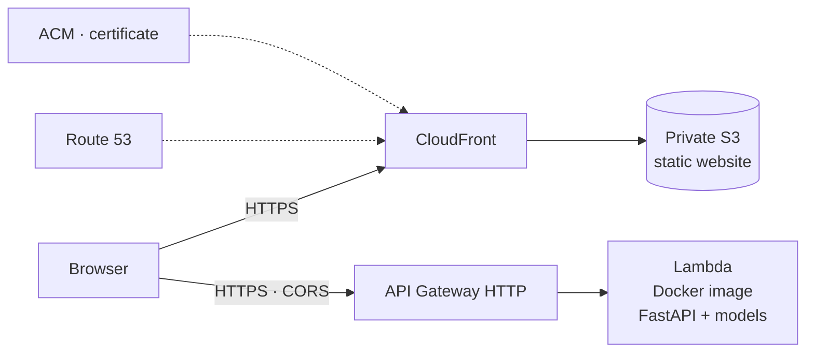

# Credit Risk Scoring · AWS Demo

**English** · [Español](README.es.md)

Credit risk model (**PD × EAD × LGD**) served as an API on AWS Lambda,
with a bilingual (EN/ES) web app to try it out.

**Live demo:** https://scoring.drm-data.com

> Academic data science project. The data and the trained model are
> **not included** in this repository (see "Data").

## What it does
Given a client and the loan terms (amount, interest rate, term, purpose
and housing), the API returns:

| Field | Meaning |
|---|---|
| `score_pd` | Probability of Default |
| `score_ead` | Exposure at Default, as a fraction of the loan |
| `score_lgd` | Loss Given Default, as a fraction |
| `perdida_esperada` | Expected loss: `PD × EAD × LGD` |

## Models and results
Trained on 140,000 loans and evaluated on 60,000 held out for validation.

| Model | Algorithm | Metric (validation) |
|---|---|---|
| PD | Logistic regression (L1, `saga`) | AUC = **0.699** |
| EAD | HistGradientBoostingRegressor | MAE = **0.160** |
| LGD | HistGradientBoostingRegressor | MAE = **0.089** |

Hyperparameters selected with `GridSearchCV` (5 folds for PD, 3 for EAD and LGD).

## Glossary
Credit risk and analysis terms used in the project.

**Credit risk**

| Term | What it is | Example |
|---|---|---|
| **PD** (Probability of Default) | Probability that the borrower stops paying the loan (0–1). | 0.15: 15 out of 100 similar loans end up in default. |
| **EAD** (Exposure at Default) | Share of the amount still owed when the borrower stopped paying: (amount − repaid) / amount. | A $10,000 loan with $4,000 repaid at default: EAD = 0.6. |
| **LGD** (Loss Given Default) | Share of that outstanding debt that is never recovered: 1 − recovered / outstanding. | $6,000 owed and $780 recovered: LGD = 0.87. |
| **Expected loss** | PD × EAD × LGD × amount: the average loss expected on the loan. | 0.15 × 0.6 × 0.87 × $10,000 = $783. |

**Analysis and models**

| Term | What it is | How to read it |
|---|---|---|
| **WoE** (Weight of Evidence) | For one group of a variable: ln(% of all good loans in the group / % of all bad loans in the group). | 0 = average risk; positive = lower risk; negative = higher risk. |
| **IV** (Information Value) | Sum over groups of (% good − % bad) × WoE: how well a variable separates good from bad loans. | < 0.02 none · 0.02–0.1 weak · 0.1–0.3 medium · > 0.3 strong (> 0.5 suggests leakage). |
| **PSI** (Population Stability Index) | Same formula as the IV, but comparing how a variable is distributed in two periods. | < 0.1 stable · 0.1–0.25 moderate shift · > 0.25 major shift. |
| **AUC** | Probability that the model ranks a random defaulted loan as riskier than a random repaid one. | 0.5 = random · 1 = perfect · 0.65–0.75 is typical with application data. |
| **Leakage** | Training with information not available at decision time (e.g. what the borrower has already repaid). | Excellent metrics in the notebook, a useless model in practice. |

## Architecture


- **API:** FastAPI wrapped with Mangum in a Docker image on AWS Lambda.
- **Web:** dependency-free HTML, CSS and JavaScript in a private S3 bucket
  served by CloudFront (access through Origin Access Control).
- **Domain and HTTPS:** Route 53 + ACM certificate.
- **Infrastructure as code:** AWS SAM / CloudFormation (`template.yaml`).

## Structure
```
07_despliegue_aws/
├── api/                      # FastAPI + Dockerfile
├── frontend/                 # Bilingual static website
├── pruebas/                  # Test events for sam local
├── template.yaml             # Infrastructure (SAM)
├── samconfig.toml.example    # Deployment configuration (template)
├── deploy.ps1                # Publishes the website to S3 and invalidates CloudFront
└── preparar_clientes.py      # Builds the demo clients CSV
```

## Tech stack
Python · scikit-learn · FastAPI · Docker · AWS (Lambda, API Gateway, S3,
CloudFront, Route 53, ACM) · AWS SAM · HTML/CSS/JavaScript.

## Data
The data comes from a data science course and is **not redistributed**.
To reproduce the project you need: the loans dataset, the pipeline artifact
(`artefacto_pipeline.pkl`, containing `pipe_pd`, `pipe_ead` and `pipe_lgd`)
and the clients CSV (`preparar_clientes.py`) inside `api/app/`.

## Deployment
```powershell
cd 07_despliegue_aws
copy samconfig.toml.example samconfig.toml   # then fill in your values
sam build
sam deploy
.\deploy.ps1                                 # publishes the website
```
Requirements: configured AWS CLI, SAM CLI and Docker.

## Limitations and next steps
- The PD model's AUC (0.70) is moderate; there is room to improve features and algorithm.
- The API is public with no authentication (limited by throttling and CORS); enough for a demo.
- The demo clients will be replaced with synthetic data.

## Author
Pedro Delgado · [drm-data.com](https://drm-data.com) · [GitHub](https://github.com/PedroDelgado08)
