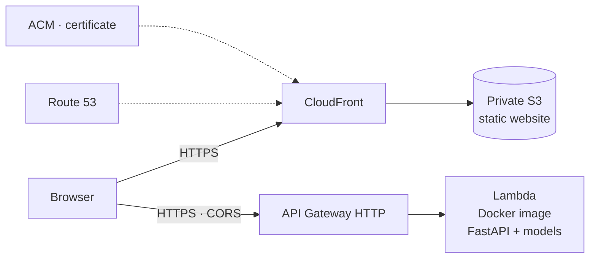

# Credit Risk Scoring · AWS Demo

**English** · [Español](README.es.md)

Three machine learning models estimate how much money a loan can lose
(**expected loss = PD × EAD × LGD**). They are trained on real Lending Club loans
and served as an API on AWS Lambda, with a bilingual (EN/ES) web app to try them out.

**Live demo:** https://scoring.drm-data.com


## What it does

The web app has two tabs:

- **Simulator.** Pick a real client from the validation sample, or create a new one, and change their data if you like. The API returns their PD, EAD, LGD and expected loss in $, along with their risk decile. For sample clients it also shows the grade Lending Club gave them and what actually happened to the loan.
- **Portfolio.** A dashboard of 20,000 scored validation loans. It shows the model's ROC curve against the Lending Club sub-grade, calibration by decile, expected vs. actual loss by grade and the PD distribution. Every chart can be filtered by year, term, grade, purpose, housing and job sector.


## Results

The models are trained on 443,469 loans and evaluated **only once** on 190,059 loans held out from the start (validation). They are completed Lending Club loans issued between 2012 and 2015.

| Model | What it estimates | Algorithm | Validation |
|---|---|---|---|
| **PD** | Probability of default | Gradient boosting (`HistGradientBoostingClassifier`) | AUC **0.678**, vs. **0.670** for the Lending Club sub-grade |
| **EAD** | Share of the amount still owed at default | Ridge regression (`alpha` 100) | RMSE 0.235, vs. 0.238 for the mean of each term |
| **LGD** | Share of the outstanding debt that is never recovered | Training mean (0.869) | RMSE 0.147: no model beat the mean |

Across the whole validation portfolio ($2.51 billion lent), the three models together predict an **expected loss of 7.75%**, against an **actual loss of 7.87%**: a 1.5% error.

## How it was built

Each step is a notebook in `03_notebooks/es/` with a report of its decisions in `00_informes/`.

| # | Notebook | What it does |
|---|---|---|
| 01 | [Data import](00_informes/01_ImportacionDatos.md) | From 2.26 million loans, keeps the 633,528 completed loans that can be modelled and splits them into training (70%) and validation (30%). |
| 02 | [Data quality](00_informes/02_CalidadDatos.md) | Reviews nulls, categories, formats and outliers. |
| 03 | [Exploratory analysis](00_informes/03_EDA.md) | Relates each variable to default (WoE, IV) and checks its stability over time (PSI). |
| 04 | [Transformation](00_informes/04_TransformacionDatos.md) | Builds the PD, EAD and LGD targets and the feature preparation (`04_scripts/preparacion.py`). |
| 05 | [PD model](00_informes/05_ModeloPD.md) | Compares logistic regression and gradient boosting with grid search and cross-validation. |
| 06 | [EAD model](00_informes/06_ModeloEAD.md) | Compares the mean, Ridge and gradient boosting on defaulted loans. |
| 07 | [LGD model](00_informes/07_ModeloLGD.md) | Same as 06, for LGD. |
| 08 | [Final validation](00_informes/08_ValidacionFinal.md) | Evaluates the three models on validation and compares expected with actual loss. |

The notebooks and reports are in Spanish. Notebooks 01 and 02 also have an English version in `03_notebooks/en/`.

## Architecture



- **API:** FastAPI adapted to Lambda with Mangum, inside a Docker image (Python 3.11) that carries the three models. The function has 1,024 MB, and the first start after a while without use takes about 4 seconds. That is why the web app calls `/health` when it opens.
- **Web:** framework-free HTML, CSS and JavaScript, with ECharts for the charts. It lives in a private S3 bucket served by CloudFront, the only service allowed to read the bucket (Origin Access Control).
- **Domain and HTTPS:** Route 53 and an ACM certificate.
- **Infrastructure as code:** everything is created with AWS SAM / CloudFormation (`template.yaml`).
- **Limits:** the API is public with no authentication. API Gateway throttles it to 5 requests per second, with bursts of 10.

### API

| Route | Method | Returns |
|---|---|---|
| `/health` | GET | `{"status": "ok"}`; used to wake up the Lambda |
| `/clientes` | GET | The validation sample clients used by the simulator |
| `/predict` | POST | PD, EAD, LGD, expected loss, risk decile and, when `id_cliente` is given, the comparison with Lending Club |

Example with a new client:

```bash
curl -X POST https://8ge1a1ntk1.execute-api.eu-central-1.amazonaws.com/predict \
  -H "Content-Type: application/json" \
  -d '[{"principal": 15000, "num_cuotas": 36, "finalidad": "debt_consolidation",
        "vivienda": "MORTGAGE", "sector_empleo": "direccion_gestion",
        "antigüedad_empleo": "2-9", "ingresos": 65000, "dti": 18.5, "fico": 700,
        "num_lineas_credito": 10, "saldo_revolving": 12000,
        "num_consultas_6meses": 1, "fecha_primer_credito": "2005-06-01"}]'
```

The full list of fields and their allowed values is in `07_despliegue_aws/api/app/schemas.py`.

## Structure

```
├── 00_informes/                # One report per notebook: decisions and results
├── 03_notebooks/
│   ├── es/                     # Notebooks 01–08
│   └── en/                     # English version (01–02)
├── 04_scripts/
│   └── preparacion.py          # Feature preparation shared by the three models
└── 07_despliegue_aws/
    ├── api/                    # FastAPI + Dockerfile
    ├── frontend/               # Bilingual static website (simulator and portfolio)
    ├── pruebas/                # Test events for sam local
    ├── preparar_datos_demo.py  # Copies the models and builds the demo data
    ├── template.yaml           # Infrastructure (SAM)
    ├── samconfig.toml.example  # Deployment configuration (template)
    └── deploy.ps1              # Publishes the website to S3 and invalidates the CloudFront cache
```

## Data and reproduction

The data is the public [*All Lending Club loan data*](https://www.kaggle.com/datasets/wordsforthewise/lending-club) dataset on Kaggle (CC0 licence). It is not included in the repository because it takes 1.7 GB. The trained models (`.pkl`) and the demo data are not included either, since they are generated from the data.

To reproduce it:

1. Download the dataset and save `accepted_2007_to_2018Q4.csv` in `02_datos/00_Originales/`.
2. Run notebooks 01 to 08 in order, with Python 3.11 and the versions in `07_despliegue_aws/api/requirements.txt`. The models are saved in `05_modelos/`.
3. Deploy:

```powershell
cd 07_despliegue_aws
python preparar_datos_demo.py                # copies the models and builds the demo data
copy samconfig.toml.example samconfig.toml   # then fill in your values
sam build
sam deploy
.\deploy.ps1                                 # publishes the website
```

Requirements: configured AWS CLI, SAM CLI and Docker.

## Limitations

- **The PD is flatter than the Lending Club grade.** It overestimates the risk of grades A and B and underestimates it from D to G. The grade uses information the form doesn't have, such as the full credit bureau history or income verification. Even so, within each grade the model ranks risk better than the sub-grades.
- **EAD and LGD can hardly be predicted from application data.** EAD improves the error of always predicting the mean by only 2.3%, and LGD is simply the mean.
- **Validation covers the same years as training (2012–2015).** It measures whether the model generalizes to similar clients, not whether it survives a change of era. In production, stability (PSI) would need monitoring and the model recalibrating.
- **The actual loss excludes** unpaid interest, collection costs and the time value of money.

## Glossary

**Credit risk**

| Term | What it is | Example |
|---|---|---|
| **PD** (Probability of Default) | Probability that the borrower stops paying the loan (0–1). | 0.15: 15 out of 100 similar loans end up in default. |
| **EAD** (Exposure at Default) | Share of the amount still owed when the borrower stopped paying: (amount − repaid) / amount. | A $10,000 loan with $4,000 repaid at default: EAD = 0.6. |
| **LGD** (Loss Given Default) | Share of that outstanding debt that is never recovered: 1 − recovered / outstanding. | $6,000 owed and $780 recovered: LGD = 0.87. |
| **Expected loss** | PD × EAD × LGD × amount: the average loss expected on the loan. | 0.15 × 0.6 × 0.87 × $10,000 = $783. |
| **Lending Club grade** | The risk rating Lending Club gave each loan: from A (lowest risk) to G, each with 5 sub-grades (A1–G5). | The benchmark the model's PD is compared with. |

**Analysis and models**

| Term | What it is | How to read it |
|---|---|---|
| **WoE** (Weight of Evidence) | For one group of a variable: ln(% of all good loans in the group / % of all bad loans in the group). | 0 = average risk; positive = lower risk; negative = higher risk. |
| **IV** (Information Value) | Sum over groups of (% good − % bad) × WoE: how well a variable separates good from bad loans. | < 0.02 none · 0.02–0.1 weak · 0.1–0.3 medium · > 0.3 strong (> 0.5 suggests leakage). |
| **PSI** (Population Stability Index) | Same formula as the IV, but comparing how a variable is distributed in two periods. | < 0.1 stable · 0.1–0.25 moderate shift · > 0.25 major shift. |
| **AUC** | Probability that the model ranks a random defaulted loan as riskier than a random repaid one. | 0.5 = random · 1 = perfect · 0.65–0.75 is typical with application data. |
| **RMSE** | Root mean squared error: how far off a numeric prediction is on average. | In the same units as the target; lower is better. |
| **Calibration** | Whether the model's probabilities match what actually happens. | If a group gets a 10% PD, about 10% of that group should default. |
| **Leakage** | Training with information not available at decision time (e.g. what the borrower has already repaid). | Excellent metrics in the notebook, a useless model in practice. |

## Tech stack

Python · pandas · scikit-learn · FastAPI · Docker · AWS (Lambda, API Gateway, S3, CloudFront, Route 53, ACM) · AWS SAM · HTML/CSS/JavaScript · ECharts

## Author

Pedro Delgado · [drm-data.com](https://drm-data.com) · [GitHub](https://github.com/PedroDelgado08)
